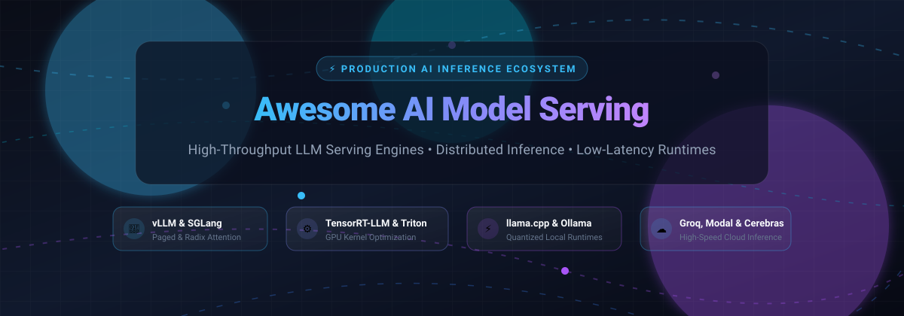

# ⚡ Awesome AI Model Serving & Inference Infrastructure

  

  
  
  
  
  
  

---

## 📌 Executive Summary & Architecture Scope

A curated directory and architectural taxonomy of **SaaS Cloud Platforms** and **Open-Source GitHub Projects** powering production-grade **AI Model Serving & Inference Infrastructure**.

Designed specifically for **MLOps Engineers**, **Inference Platform Architects**, and **AI System Developers**, this repository tracks tools built to maximize **Tokens-Per-Second (TPS)** throughput, slash **Time-To-First-Token (TTFT)**, eliminate memory waste via **PagedAttention** and **RadixAttention**, accelerate execution through custom GPU kernels (**FlashAttention-3**, **FlashInfer**), implement advanced quantization schemes (**FP8, FP4, AWQ, GPTQ, EXL2, GGUF**), and orchestrate scalable multi-node inference clusters.

---

## 📑 Table of Contents

- [🌐 Sector Overview & Market Dynamics](#-sector-overview--market-dynamics)
- [☁️ SaaS & Hosted Inference Platforms](#️-saas--hosted-inference-platforms)
- [🛠️ Open-Source GitHub Projects](#️-open-source-github-projects)
  - [🚀 High-Throughput LLM & VLM Serving Engines](#-high-throughput-llm--vlm-serving-engines)
  - [⚙️ Multi-Framework Model Serving & Cluster Orchestration](#️-multi-framework-model-serving--cluster-orchestration)
  - [💻 Quantized Local & Edge Runtimes](#-quantized-local--edge-runtimes)
  - [🔬 Low-Level Acceleration Kernels & Memory Optimization](#-low-level-acceleration-kernels--memory-optimization)
  - [🔀 Inference Gateways, Routing & Proxy Layers](#-inference-gateways-routing--proxy-layers)
- [📈 Star History](#-star-history)
- [🤝 How to Contribute](#-how-to-contribute)
- [💖 Support & Sponsorship](#-support--sponsorship)
- [📜 Disclaimer & License](#-disclaimer--license)

---

## 🌐 Sector Overview & Market Dynamics

The global AI inference infrastructure market is valued at approximately **$115B–$130B** and is projected to expand to over **$400B by the early 2030s** at an annual growth rate (CAGR) exceeding **18%–24%**, as enterprise spending pivots aggressively from one-off model training to high-volume production inference. The sector displays a bifurcated market dynamic: foundational accelerator hardware and hyperscale compute distribution are **heavily concentrated** (dominated by NVIDIA and the major hyperscalers), whereas the inference serving software layer, custom silicon ASICs (LPUs, RDUs, WSEs), and specialized serverless orchestration stacks remain **highly fragmented** with intense competition driven by price-per-token efficiencies and latency optimizations.

---

## ☁️ SaaS & Hosted Inference Platforms

The following SaaS and managed neocloud platforms deliver high-throughput, low-latency inference endpoints for open-weight foundation models and custom containerized deployments. Entries are ordered descending by company market valuation / capitalization.

| Company / Product | Size (Valuation / Revenue) | Starting Tier Pricing | Free Tier Limits (Perpetual / Trial) | Core Focus & Infrastructure Strengths |
| :--- | :--- | :--- | :--- | :--- |
| **[NVIDIA NIM](https://build.nvidia.com)** | **$3.6 Trillion** *(Public Market Cap: NVDA)* | **$4,500 / GPU / year** *(NVIDIA AI Enterprise production license)* or **~$1.00 / GPU-hour** via hyperscaler marketplaces | **1,000 free API credits** on `build.nvidia.com` sandbox (no credit card required; rate limited to ~40 RPM for prototyping across 100+ models) | Enterprise-grade inference microservices providing pre-optimized TensorRT-LLM and vLLM containers with unified OpenAI-compliant APIs. |
| **[Cerebras Inference](https://cerebras.ai)** | **~$18 Billion** *(Public Post-IPO / NASDAQ: CBRS)* | **$0.10 / 1M input tokens**, **$0.20 / 1M output tokens** *(Llama 3.1 8B Developer Tier)* | **$5.00 one-time credit** (requires linked card, valid for 30 days of evaluation testing) | Ultra-fast token generation reaching 1,800+ tokens/sec powered by massive Wafer-Scale Engines (`WSE-3`). |
| **[Fireworks AI](https://fireworks.ai)** | **$18 Billion** *(Latest Private Valuation)* | **$0.05 / 1M input tokens**, **$0.20 / 1M output tokens** *(Serverless light tiers; 50% discount on Batch API)* | **$1.00 instant sign-up credit** (no upfront card required) + promotional Fire Pass trials for newly released models | High-performance compound inference engine with custom CUDA kernels, speculative decoding, and dedicated GPU endpoints. |
| **[Baseten](https://baseten.co)** | **$13 Billion** *(Series F Valuation)* | **$0.005 / min** *(CPU)*, **$0.016 / min (~$0.95/hr)** *(NVIDIA L4)*, billed down to the second | **$30.00 free credit grant** upon signup (no monthly subscription fee; pure usage-based scale-to-zero compute) | Enterprise ML model deployment engine featuring Truss packaging, automatic cold-start optimization, and TensorRT-LLM runtimes. |
| **[SambaNova Cloud](https://sambanova.ai)** | **$11 Billion** *(Series F Valuation)* | **$0.10 / 1M input tokens**, **$0.20 / 1M output tokens** *(Llama 3.1 8B Pay-As-You-Go)* | **Perpetual Free Plan** without credit card (strictly capped at 30 RPM, 30,000 TPD for testing) + **$5.00 trial credit** when activating pay-as-you-go | Custom Reconfigurable Dataflow Unit (`RDU SN40L/SN50`) silicon delivering deterministic, ultra-fast token streaming. |
| **[Together AI](https://together.ai)** | **$8.3 Billion** *(Series C Valuation)* | **$0.18 / 1M input tokens**, **$0.18 / 1M output tokens** *(Serverless 8B models; $15 minimum initial top-up)* | **No recurring free tier**; requires $15 initial deposit (offers up to **$50,000 in startup program credits** for venture-backed teams) | Enterprise AI neocloud providing serverless token APIs, dedicated GPU clusters, and custom model fine-tuning. |
| **[Groq Cloud](https://groq.com)** | **$3.5 Billion** *(Post-Restructure Series A/B)* | **$0.05 / 1M input tokens**, **$0.08 / 1M output tokens** *(Llama 3.1 8B on Pay-As-You-Go Developer Plan)* | **Perpetual Free Tier** (organization-wide limits: up to **30 RPM**, **30,000 TPM**, and **500,000 TPD** per model without credit card) | Deterministic, ultra-low TTFT inference cloud running on custom Language Processing Units (`LPUs`). |
| **[Modal](https://modal.com)** | **$2.5 Billion** *(Private Valuation)* | **$0.000100 / CPU-sec**, **$0.000164 / sec (~$0.59/hr)** *(NVIDIA T4)*, **$0.001222 / sec (~$4.40/hr)** *(NVIDIA A100-80GB)* | **$30.00 every month free compute credit** perpetually (includes up to 10 concurrent GPUs, 100 containers, 1 TiB free egress) | Serverless developer cloud enabling instant deployment of custom vLLM and SGLang endpoints with sub-second cold starts. |
| **[Anyscale](https://anyscale.com)** | **$1.65 Billion** *(Acquired by Nscale)* | **$0.5682 / hr** *(NVIDIA T4 instance)*, **$1.3635 / hr** *(NVIDIA A10G)* on Anyscale Managed Compute | **$100.00 free starting credit** upon account setup (plus up to **$20,000 startup acceleration grant** for eligible teams) | Managed distributed computing and Ray Serve inference orchestrator supporting multi-model pipelines and elastic autoscaling. |
| **[Replicate](https://replicate.com)** | **$350 Million** *(Acquired by Cloudflare)* | **$0.000140 / sec (~$0.50/hr)** *(NVIDIA T4)*, **$0.000725 / sec (~$2.61/hr)** *(NVIDIA A100-40GB)* | **Trial playground runs** (limited free trial model generations on select public endpoints before pay-as-you-go activation) | One-line API model platform packaging custom models into Cog Docker containers with automatic serverless scale-to-zero. |

---

## 🛠️ Open-Source GitHub Projects

A ranked collection of open-source projects essential for building, optimizing, and deploying AI inference infrastructure. All repositories feature an official stargazers badge linking directly to their stargazers page and are sorted descending by GitHub Stars_Count.

---

### 🚀 High-Throughput LLM & VLM Serving Engines

Production-ready inference engines engineered for high batch throughput, advanced attention caching, and low TTFT.

- **[Ollama (`ollama/ollama`)](https://github.com/ollama/ollama)**   
  *Foundational local model runner and OpenAI-compatible server packaging quantized GGUF weights, multi-platform GPU offloading, and single-command local serving.*

- **[llama.cpp (`ggml-org/llama.cpp`)](https://github.com/ggml-org/llama.cpp)**   
  *Groundbreaking pure C/C++ LLM inference engine supporting 1.5-bit to 8-bit quantization across CPU, Apple Metal, NVIDIA CUDA, AMD ROCm, and Vulkan.*

- **[vLLM (`vllm-project/vllm`)](https://github.com/vllm-project/vllm)**   
  *The industry standard for high-throughput LLM serving featuring PagedAttention, continuous batching, chunked prefill, speculative decoding, and native FP8/AWQ/GPTQ runtimes.*

- **[LocalAI (`mudler/LocalAI`)](https://github.com/mudler/LocalAI)**   
  *Self-hosted, drop-in OpenAI alternative running LLMs, embeddings, audio transcription, and image synthesis across consumer CPUs and GPUs without external internet connectivity.*

- **[DeepSpeed & DeepSpeed-MII (`deepspeedai/DeepSpeed`)](https://github.com/deepspeedai/DeepSpeed)**   
  *Microsoft's deep learning optimization framework delivering low-latency inference via blocked KV caching (`DeepSpeed-FastGen`), ZeRO-Inference, and kernel injection.*

- **[AirLLM (`lyogavin/airllm`)](https://github.com/lyogavin/airllm)**   
  *Innovative layer-wise inference library enabling 70B and 405B parameter models to execute on a single 4GB or 8GB GPU via smart SSD-to-VRAM block caching.*

- **[SGLang (`sgl-project/sglang`)](https://github.com/sgl-project/sglang)**   
  *Ultra-fast serving framework for LLMs and VLMs featuring RadixAttention automatic prefix caching, zero-overhead scheduling, and high-performance structured JSON decoding.*

- **[Apple MLX & MLX-LM (`ml-explore/mlx`)](https://github.com/ml-explore/mlx)**   
  *Apple Silicon optimized machine learning array framework engineered for unified memory architecture with 4-bit and 8-bit hardware-accelerated quantization.*

- **[Hugging Face Candle (`huggingface/candle`)](https://github.com/huggingface/candle)**   
  *Minimalist, lightning-fast Rust ML framework designed for serverless, low-overhead deployments, WebAssembly in-browser runtimes, and CPU/CUDA inference.*

- **[ktransformers (`kvcache-ai/ktransformers`)](https://github.com/kvcache-ai/ktransformers)**   
  *Flexible CPU/GPU hybrid offloading framework utilizing custom llamafile CPU kernels to run massive 671B MoE architectures (such as DeepSeek-V3/R1) on consumer desktop workstations.*

- **[GGML Tensor Library (`ggerganov/ggml`)](https://github.com/ggerganov/ggml)**   
  *Underlying tensor library in C/C++ powering llama.cpp and whisper.cpp, providing low-overhead SIMD, Metal, and CUDA accelerated matrix primitives.*

- **[NVIDIA TensorRT-LLM (`NVIDIA/TensorRT-LLM`)](https://github.com/NVIDIA/TensorRT-LLM)**   
  *NVIDIA's compiler and runtime engine optimizing LLM inference with custom tensor cores, in-flight batching, FP8/FP4 GEMM execution, and multi-GPU tensor parallelism.*

- **[Text Generation Inference / TGI (`huggingface/text-generation-inference`)](https://github.com/huggingface/text-generation-inference)**   
  *Production-ready Rust/Python LLM serving engine built by Hugging Face powering HuggingChat with FlashAttention, continuous batching, and watermarking.*

- **[Xinference (`xorbitsai/inference`)](https://github.com/xorbitsai/inference)**   
  *All-in-one distributed inference platform for LLMs, image models, and speech models with multi-node scheduling and OpenAI API compatibility.*

- **[ExLlamaV2 (`turboderp-org/exllamav2`)](https://github.com/turboderp-org/exllamav2)**   
  *High-speed local inference library specialized in variable-bitrate EXL2 quantization delivering maximum single-GPU and multi-GPU token generation speeds.*

- **[LitServe (`Lightning-AI/LitServe`)](https://github.com/Lightning-AI/LitServe)**   
  *High-performance, lightweight serving engine by Lightning AI featuring automatic dynamic request batching, streaming, and multi-model compounding.*

---

### ⚙️ Multi-Framework Model Serving & Cluster Orchestration

Enterprise-grade frameworks designed to deploy, autoscale, and coordinate complex multi-model pipelines across Kubernetes and multi-cloud GPU instances.

- **[Ray Serve (`ray-project/ray`)](https://github.com/ray-project/ray)**   
  *Scalable model serving library built on Ray for constructing distributed inference pipelines, multi-model dynamic routing, and fractional GPU sharing.*

- **[Axolotl (`OpenAccess-AI-Collective/axolotl`)](https://github.com/OpenAccess-AI-Collective/axolotl)**   
  *Streamlined toolkit for post-training, fine-tuning, and preparing quantized checkpoints for immediate production serving.*

- **[NVIDIA Triton Inference Server (`triton-inference-server/server`)](https://github.com/triton-inference-server/server)**   
  *Enterprise multi-backend inference server orchestrating PyTorch, TensorRT-LLM, vLLM, and ONNX Runtime with dynamic batching and concurrent model execution.*

- **[Cog (`replicate/cog`)](https://github.com/replicate/cog)**   
  *Open-source containerization tool that packages machine learning models into reproducible, production-ready Docker containers with automatic API generation.*

- **[BentoML (`bentoml/BentoML`)](https://github.com/bentoml/BentoML)**   
  *Unified model serving platform enabling engineering teams to package, compose, and deploy multi-model pipelines to Kubernetes or serverless cloud clusters.*

- **[KServe (`kserve/kserve`)](https://github.com/kserve/kserve)**   
  *Cloud-native Kubernetes serving controller providing serverless autoscaling (including scale-to-zero), canary rollouts, and standardized vLLM/Triton runtimes.*

---

### 💻 Quantized Local & Edge Runtimes

Lightweight and edge-focused runtimes designed for cross-platform deployment, CPU acceleration, and edge NPUs.

- **[Microsoft ONNX Runtime (`microsoft/onnxruntime`)](https://github.com/microsoft/onnxruntime)**   
  *High-performance cross-platform inferencing engine accelerating models across Windows DirectML, NVIDIA TensorRT, OpenVINO CPUs, and mobile NPUs.*

- **[AutoGPTQ (`PanQiWei/AutoGPTQ`)](https://github.com/PanQiWei/AutoGPTQ)**   
  *Easy-to-use 4-bit quantization package based on the GPTQ algorithm with user-friendly APIs and high-performance CUDA/Triton kernels.*

- **[ExLlama (`turboderp/exllama`)](https://github.com/turboderp/exllama)**   
  *Standalone first-generation C++/CUDA implementation of the 4-bit GPTQ algorithm designed specifically for high-speed single-card LLM serving.*

- **[AutoAWQ (`casper-hansen/AutoAWQ`)](https://github.com/casper-hansen/AutoAWQ)**   
  *Efficient 4-bit Activation-aware Weight Quantization package boosting serving speed by up to 3x while preserving model perplexity across consumer GPUs.*

---

### 🔬 Low-Level Acceleration Kernels & Memory Optimization

Foundational CUDA/C++ kernels and disaggregated memory systems that power modern LLM inference architectures.

- **[FlashAttention (`Dao-AILab/flash-attention`)](https://github.com/Dao-AILab/flash-attention)**   
  *Fast and memory-efficient exact attention algorithm with IO-awareness powering virtually every production inference engine in existence.*

- **[Mooncake (`kvcache-ai/Mooncake`)](https://github.com/kvcache-ai/Mooncake)**   
  *KVCache-centric disaggregated architecture separating prefill and decode clusters to maximize GPU efficiency and bypass memory bandwidth bottlenecks.*

- **[FlashInfer (`flashinfer-ai/flashinfer`)](https://github.com/flashinfer-ai/flashinfer)**   
  *High-performance GPU kernel library specifically customized for LLM serving, featuring state-of-the-art PagedAttention, speculative verification, and FP8 kernels.*

---

### 🔀 Inference Gateways, Routing & Proxy Layers

Smart reverse proxies and unified gateways providing fallbacks, load-balancing, rate-limiting, and cost observability across multiple inference backends.

- **[LiteLLM Proxy (`BerriAI/litellm`)](https://github.com/BerriAI/litellm)**   
  *High-speed AI gateway to call 100+ LLM APIs using the OpenAI format with built-in load-balancing, spend tracking, key management, and automatic retries.*

- **[TensorZero (`tensorzero/tensorzero`)](https://github.com/tensorzero/tensorzero)**   
  *Production inference gateway engineering LLM routing, fallback policies, metric evaluation, dynamic model caching, and multi-provider observability.*

---

## 📈 Star History

---

## 🤝 How to Contribute

Contributions to expand this inference infrastructure guide are warmly welcome! 

1. 🍴 **Fork** this repository.
2. 🌿 **Create a new branch** (`git checkout -b add/new-engine`).
3. 📝 **Add your entry** under the appropriate category. Ensure links are working, descriptions are factual, and any SaaS entries include exact pricing and free tier terms.
4. 🚀 **Submit a Pull Request** with a concise description of why the tool is valuable to the AI inference community.

Check out [Awesome-Awesome-Awesome](https://github.com/ishandutta2007/Awesome-Awesome-Awesome) for more curated high-impact engineering lists!

---

## 💖 Support & Sponsorship

If this curated inference infrastructure directory helped you design, benchmark, or scale your production AI serving stack, please consider supporting the project:

- ⭐ **Star this repository** to help other engineers discover it!
- 🍴 **Fork and share** it with your MLOps and infrastructure colleagues.
- ☕ **Buy a coffee & sponsor ongoing research:** Visit the [GitHub Sponsors Dashboard](https://github.com/sponsors/ishandutta2007).

Your sponsorship helps keep benchmarks, pricing tables, and open-source project tracking continuously updated!

---

## 📜 Disclaimer & License

*Product names, logos, and brands are property of their respective owners. Pricing tiers, free quotas, and market valuations are documented as of November 2026 and are subject to vendor updates.*

Distributed under the **MIT License**. See [LICENSE](LICENSE) for more information.
